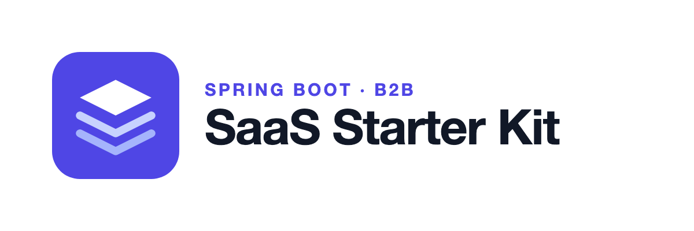
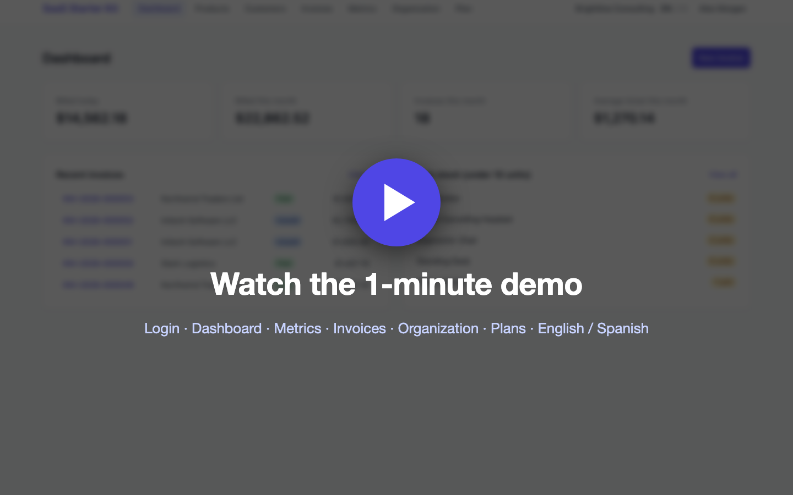
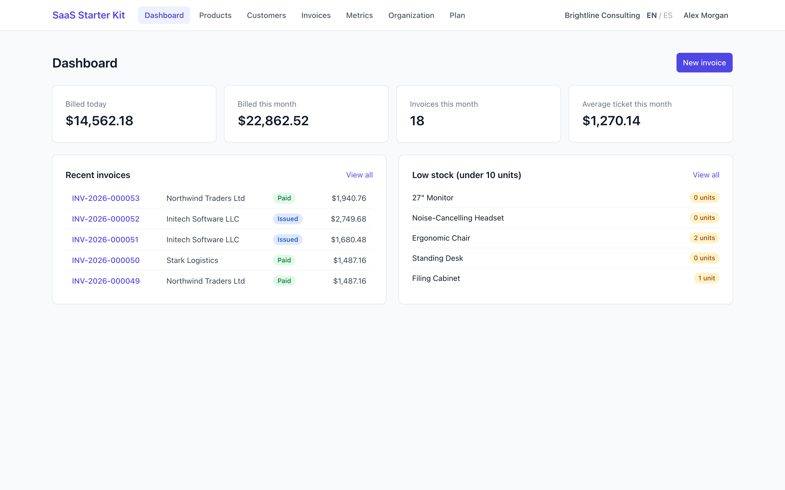
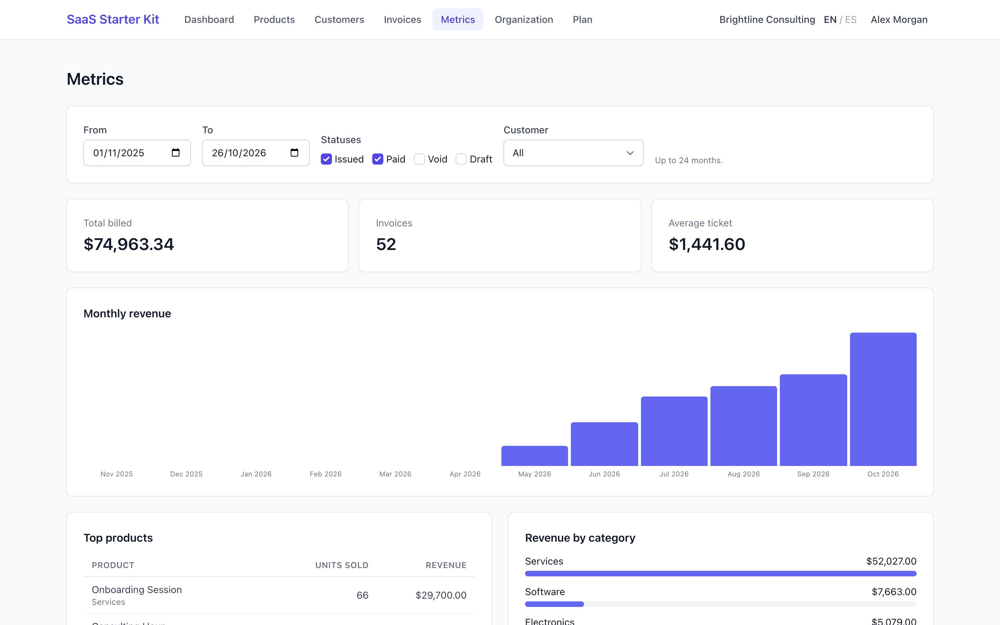
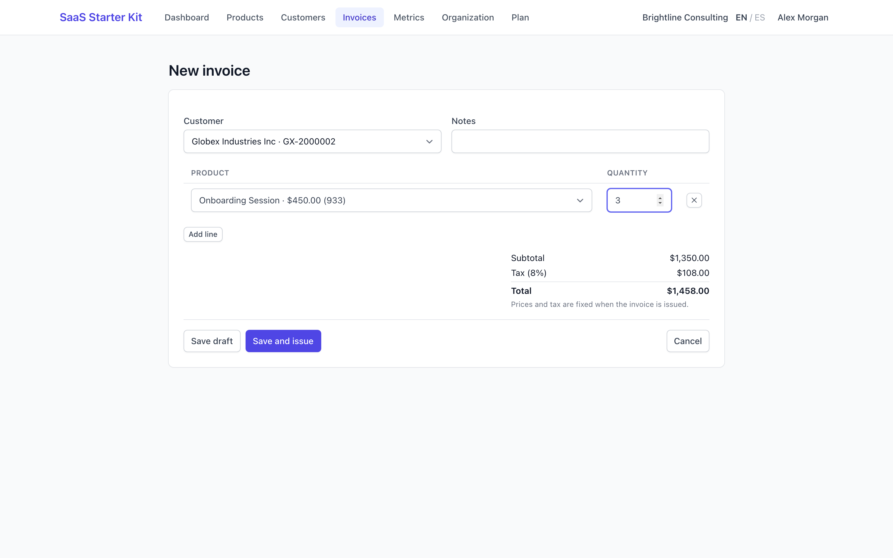
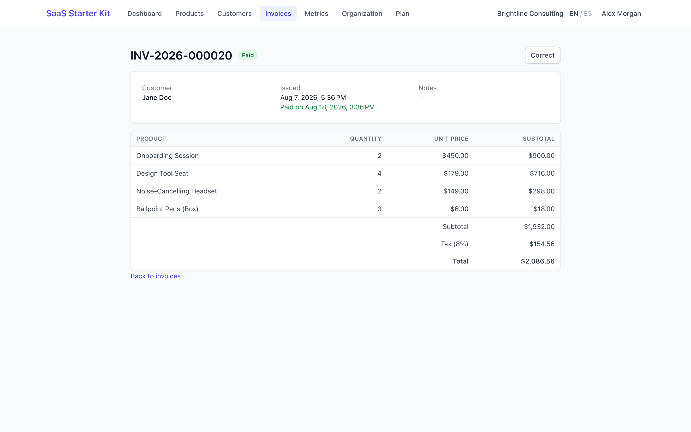
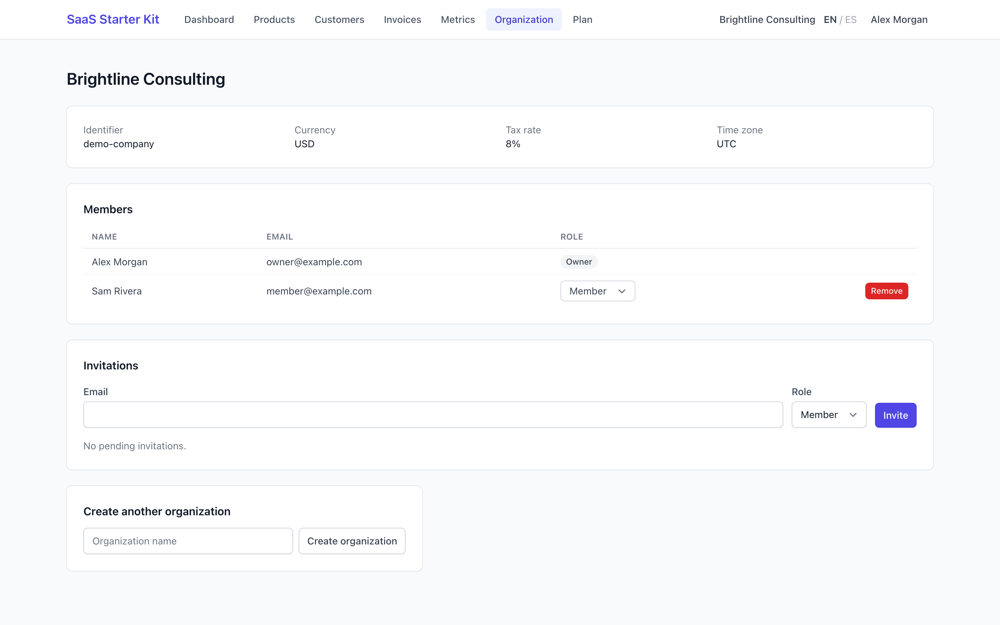
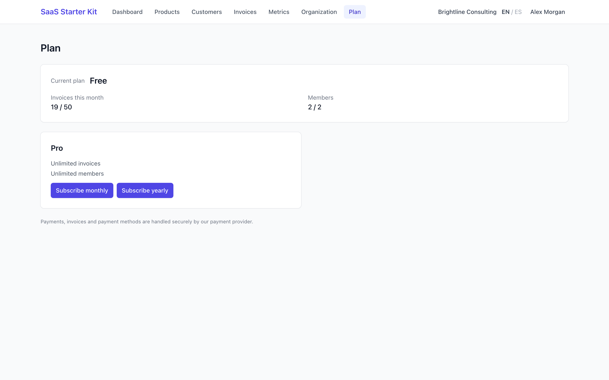
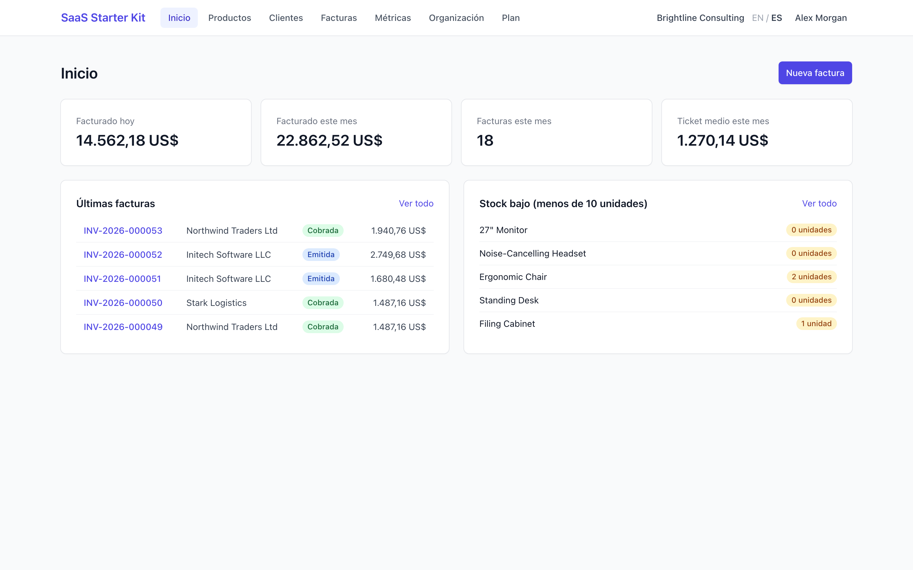
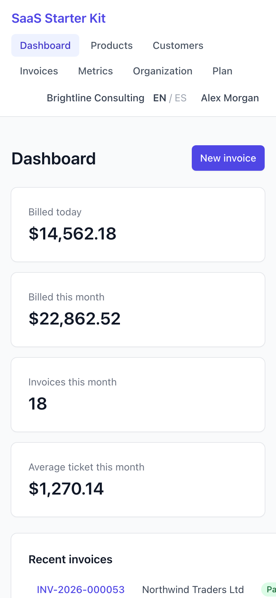

  <picture>
    <source media="(prefers-color-scheme: dark)" srcset="images/logo-wide-dark.png">
    
  </picture>

  <strong>A production-ready, multi-tenant B2B SaaS foundation for Java 25 and Spring Boot 4.</strong> 
  Accounts, organizations, tenant isolation, Stripe subscriptions, invoicing and a bilingual UI: done, tested and documented.

  

  
  
  
  
  

> This repository is the public overview of a **commercial** starter kit. The source code lives in a private
> repository that buyers get read access to right after purchase.

## Demo

## Why this kit

Every B2B SaaS needs the same foundation before its first real feature: accounts, organizations, roles,
invitations, data that never leaks between customers, email, billing, security headers, a deployable image. This
kit gives you all of it in idiomatic Spring Boot, so your first week goes into what your customers pay for.

## What's inside

| | |
|---|---|
| **Accounts** | Sign-up with email verification, login, password reset, "log out everywhere"; session cookies for the web UI, JWT access + rotating refresh tokens (with reuse detection) for API clients |
| **Organizations** | Each customer is a tenant with members, roles (`OWNER` / `ADMIN` / `MEMBER`), email invitations and an organization switcher |
| **Tenant isolation** | Hibernate `@TenantId` on every business table, fail-closed when no tenant is bound, composite foreign keys in MySQL, cross-tenant isolation tests |
| **Billing (optional)** | Plans and limits from configuration; Stripe Checkout, Customer Portal and signed webhooks behind a provider interface |
| **Invoicing** | Customers, products with stock, invoices (draft → issued → paid / void) with gapless per-tenant numbering, corrective invoices, a filterable metrics dashboard |
| **Email** | Transactional outbox with retries, HTML + text templates in English and Spanish |
| **Web UI** | Server-rendered Thymeleaf + HTMX + Tailwind, English / Spanish, mobile friendly, one-line brand color |
| **Security** | CSRF, strict Content-Security-Policy, rate limiting (in memory or Redis), hashed tokens, ProblemDetail errors |
| **Operations** | Flyway migrations, production Docker image, Compose example, health probes, GitHub Actions CI, Dependabot |
| **Tests** | 130+ integration and unit tests against real MySQL and Redis (Testcontainers) |

## Screenshots

| | |
|---|---|
|  |  |
| **Dashboard** | **Metrics** with live filters |
|  |  |
| **Invoice editor** with live totals | **Invoice** lifecycle and tax |
|  |  |
| **Organization**: members, roles, invitations | **Plan**: Stripe subscriptions and limits |
|  |  |
| **Spanish** out of the box | **Mobile** |

## Built for Claude Code

The kit ships with a `CLAUDE.md` (architecture rules: tenancy, money, security, i18n) and 9 project skills for the
changes you will make most: a tenant-scoped entity, a REST endpoint, a UI page, a migration, an email, a metric, a
plan limit, a configuration setting. Ask Claude Code for a feature and it follows the kit's conventions, including
the tenant isolation tests. Not using AI? The skills are plain Markdown checklists that work just as well for humans.

## Documentation included

Local setup · customizing (rename the package, brand color, logo, languages, removing the example domain) · Stripe
setup in test and live mode · deployment with a go-live checklist · security overview · changelog with update notes.

## Tech stack

Java 25 · Spring Boot 4.1 · Spring Security 7 · Hibernate 7 · MySQL 8.4 · Flyway · Thymeleaf · HTMX 2 · Tailwind CSS ·
Docker · Testcontainers. Stripe, SMTP and Redis are optional.

## What you get

- **Read access to the private GitHub repository**, right after purchase: pull future versions with `git`.
- **A zip** of the latest release, if you prefer not to use git.
- **License**: use it in unlimited products of your own, commercial or not. Redistributing the kit itself is not
  allowed.
- **14-day bug-fix guarantee**: if a bug keeps it from working as described and it isn't fixed within 7 days of your
  report, you get a full refund.

  

## FAQ

**Is this a hosted service?** No. It is source code you own and deploy wherever you want.

**Do I need Stripe?** No. Billing turns on only when you add a Stripe key; without it every organization is unlimited.

**My SaaS doesn't do invoicing. Is it still useful?** Yes. Accounts, organizations, tenancy, email, billing and
security are independent of the invoicing example, and the docs explain how to remove it.

**Which database?** MySQL 8.4, with Flyway migrations.

**Questions?** nico.neg88@outlook.com
